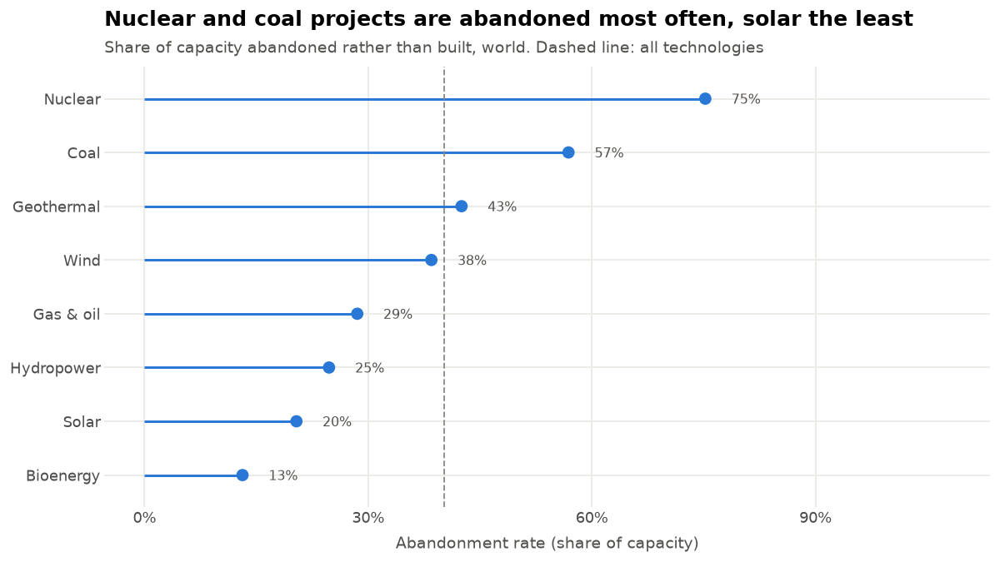
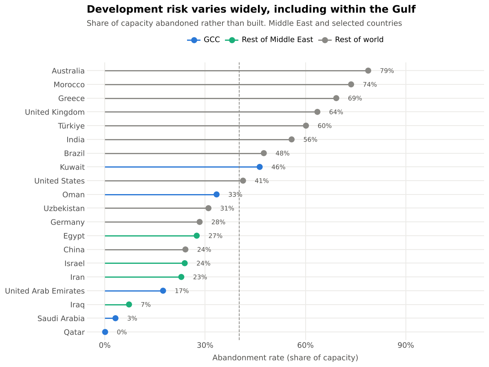
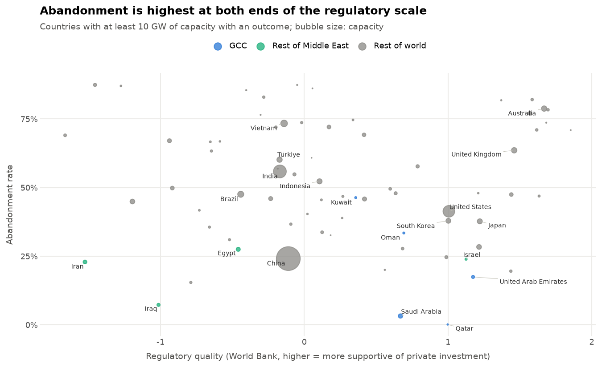
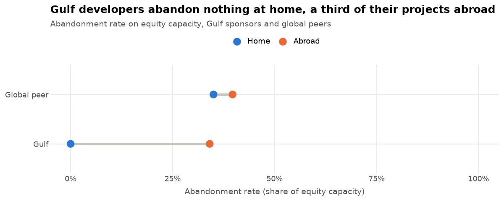
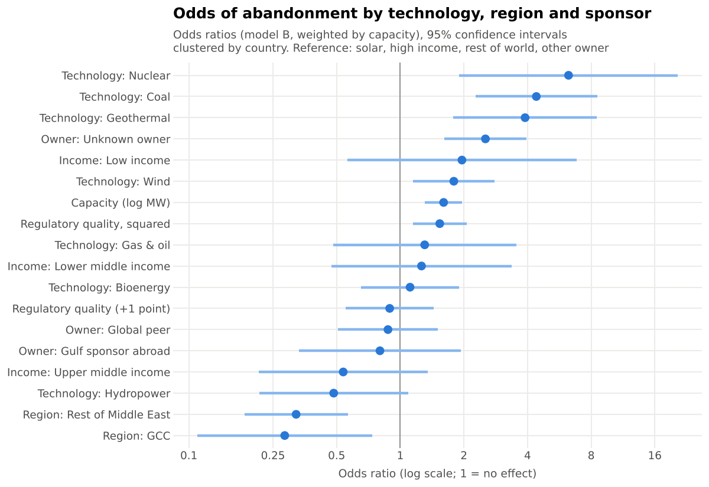
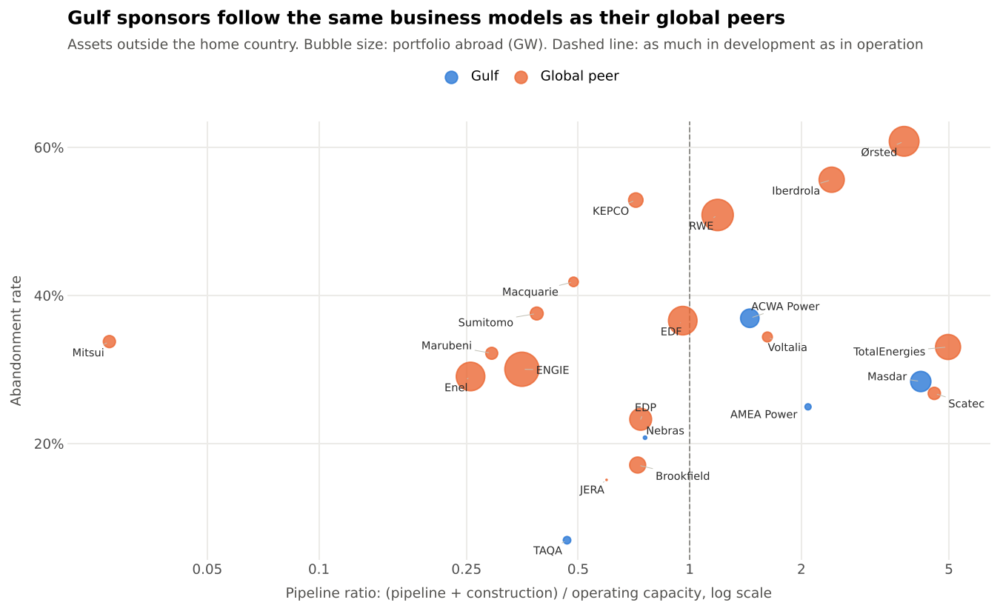

# Which Power Projects Actually Get Built?
### Development Risk in the Middle East and Beyond

*ENSAE Paris, Python for Data Science (2026-2027)*
*Sylvain Topeza, Maxime Rolland, Arcadius Kouwagou.*

Governments and companies announce far more power plants than they build. For anyone who
finances or invests in infrastructure, the gap between announcement and construction is
the core of **development risk**: the risk that a project dies before it is built.

Using asset-level data on about **180,000 power units worldwide**, this project asks:

> **Which power projects actually get built, and why?**

1. **How much of what is announced gets built?**
2. **Where is development risk highest?** With a focus on the Middle East, where a single
   state buyer tenders most new capacity.
3. **Is it the market or the developer?** We follow the same Gulf developers (ACWA Power,
   Masdar, TAQA...) at home and abroad, and compare them with 18 global peers (ENGIE, EDF,
   Ørsted, Brookfield...).

📓 **The full report is the notebook [`main.ipynb`](main.ipynb).**

---

## Key findings

**1. About 40% of the capacity that reached an outcome was abandoned rather than built 
(between 32% and 48% depending on the definition).** Solar is the safest technology to 
develop (20% abandoned), coal (57%) and nuclear (75%) the riskiest.



**2. Development risk depends on the market.** Gulf countries abandon 14% of their
capacity against 41% in the rest of the world, with Saudi Arabia (3%) and Qatar (0%) close
to zero: a state buyer tenders projects and signs long-term contracts before they become
public. Kuwait (46%) is the exception. High rates are found in fragile countries, but also
in rich, open markets such as the United Kingdom (64%) or Australia (79%), where developers
compete and carry the early risk themselves. The relationship with the quality of regulation, 
measured by the World Bank, is U-shaped: abandonment is highest both where institutions are 
weak (49%) and in the best-regulated, most open markets (57%), against 37% in between. What 
matters is who selects the projects.





**3. The developer matters less than the market.** Gulf developers abandoned none of their
projects at home, but 34% abroad, close to their Western and Asian peers (40%). In a
logistic regression controlling for technology, size and location, having a large
international sponsor does not change the odds of abandonment.





**What it means for infrastructure investors.** A pipeline must be valued market by market;
a developer's record in a protected home market does not transfer abroad; and acquirers of
operating assets (Brookfield, TAQA) avoid most development risk, which is the trade-off
between core and value-add infrastructure strategies.



---

## Data

| Source | Content | Access |
|---|---|---|
| [Global Integrated Power Tracker](https://globalenergymonitor.org/projects/global-integrated-power-tracker/), Global Energy Monitor, September 2026 | 183,404 power units: technology, capacity, status, start year, owners, location | Distributed through a download form, so it cannot be fetched by code from the source. We mirror the raw file, unchanged, at a public URL on SSP Cloud storage (licence CC BY 4.0); the code downloads it |
| [World Bank API](https://datahelpdesk.worldbank.org/knowledgebase/articles/889392) | Income group, GDP per capita, Regulatory Quality (Worldwide Governance Indicators) | Queried by `src/worldbank.py`; a snapshot is saved in `data/worldbank_snapshot.csv` in case the API is down |
| [ISO country codes](https://github.com/datasets/country-codes) | Country names and ISO codes, to join the two sources | Read from a public URL |
| `data/sponsors.csv` | 30 sponsor groups: name patterns, home country | Built by hand |

## Method

1. **Cleaning** (`src/clean.py`): select and rename columns; group the ten GEM statuses
   into four stages (pipeline, construction, operating, abandoned); add ISO codes;
   extract owners and ownership shares from text fields with regular expressions; group
   subsidiaries under 30 sponsor groups.
2. **Indicator** (`src/indicators.py`): the abandonment rate, weighted by capacity:
   abandoned MW / (abandoned MW + MW under construction or commissioned since 2010).
   Robustness checks with a 2015 cut-off and without inferred statuses.
3. **Descriptive analysis and maps** (`src/plots.py`) by technology, country and sponsor.
4. **Logistic regression** (`src/model.py`) of abandonment on technology, size, country
   characteristics and sponsor type, with standard errors clustered by country.

## Limits

- The tracker is a snapshot with no announcement dates: we cannot follow cohorts of
  projects over time.
- Projects enter the data at different stages depending on the market (permit
  applications in open markets, awarded tenders in the Gulf), which partly explains the
  low rates of tender-based markets.
- Owners are unknown for many small solar projects; when ownership shares are missing,
  capacity is split equally between owners.

## Repository structure

```
├── main.ipynb                  # Final report: run all cells to reproduce
├── src/
│   ├── config.py               # Paths, definitions and constants
│   ├── load.py                 # Data import (SSP Cloud storage, local cache)
│   ├── clean.py                # Cleaning, ownership parsing, sponsor groups
│   ├── worldbank.py            # World Bank API collection
│   ├── indicators.py           # Abandonment rates and sponsor profiles
│   ├── model.py                # Logistic regression
│   └── plots.py                # Charts (plotnine) and maps (plotly)
├── data/
│   ├── sponsors.csv            # Hand-built sponsor dictionary
│   └── worldbank_snapshot.csv  # Saved World Bank data
├── figures/                    # Charts used in this README
├── fetch_worldbank_snapshot.py # Refreshes the World Bank snapshot
└── requirements.txt
```

## How to run

The project runs on any computer with **Python 3.11+** and an internet connection
(it was developed on the [SSP Cloud](https://datalab.sspcloud.fr)).

```bash
git clone https://github.com/<user>/power-projects-development-risk.git
cd power-projects-development-risk
pip install -r requirements.txt
```

Then open `main.ipynb` and run all cells. The first run downloads the raw data (30 MB)
into `data/raw/` and caches it as Parquet in `data/cache/` (about one minute); later runs
take a few seconds. To work offline, place the Excel file in `data/raw/` yourself.

The interactive maps are rendered when the notebook is run; they are not displayed in
GitHub's static preview.

## Data attribution

Global Energy Monitor, *Global Integrated Power Tracker*, September 2026 release, licensed
under [CC BY 4.0](https://creativecommons.org/licenses/by/4.0/). World Bank, *World
Development Indicators* and *Worldwide Governance Indicators*.
